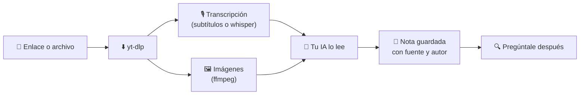

<div align="center">


# Enseña a tu IA con videos cortos

**Pega un Reel, TikTok o YouTube Short. Tu IA lo ve, lo escucha y *recuerda lo que aprendió*.**

[](https://github.com/MesaRestrepo/aprende-de-videos/actions/workflows/ci.yml)
[](LICENSE)


[](CONTRIBUTING.md)

[English](README.md) · **Español** · [Português](README.pt-BR.md) · [Français](README.fr.md) · [中文](README.zh-CN.md)

</div>

---

```text
Tú:   aprende de este tiktok https://www.tiktok.com/@user/video/123
IA:   Aprendí: cómo hacer pan sin horno, en 4 pasos.
      Guardado en  cocina/pan-sin-horno

        … días después …

Tú:   ¿cómo era lo del pan sin horno?
IA:   Según tu nota cocina/pan-sin-horno (fuente: @user) …
```

## ✨ Qué incluye

| | |
|---|---|
| 🎓 **`aprender-de-video`** | Descarga o lee el video, transcribe la voz, extrae imágenes, escribe una nota y la guarda. |
| 🔎 **`consultar-conocimiento`** | Busca en tus notas antes de responder y cita la fuente. |
| 🛠️ **`procesar_video.py`** | URL o archivo → `material.md` con datos, transcripción con tiempos e imágenes. |
| 🗂️ **`conocimiento.py`** | Guardar, buscar, listar, ver y borrar notas. Markdown plano, en tu disco. |

## 🚀 Instalar

Necesitas **Python 3.10+** (probado en 3.11) y **[ffmpeg](https://ffmpeg.org/download.html)**.

```bash
# 1. ffmpeg (una vez)
winget install Gyan.FFmpeg        # Windows
brew install ffmpeg               # macOS
sudo apt install ffmpeg           # Linux

# 2. instalar
git clone https://github.com/MesaRestrepo/aprende-de-videos
cd aprende-de-videos
python install.py
```

El instalador crea su propio entorno aislado (tu Python queda limpio), instala `yt-dlp` y `faster-whisper`, copia las skills a `~/.claude/skills` y verifica todo. Reinicia tu IA.

Actualizar: `git pull && python install.py`  ·  Quitar: `python install.py --desinstalar` (tus notas se conservan).

## 💬 Usar

- *"Aprende de este reel: `<url>`"*
- *"Estudia estos 3 videos y hazme un resumen: `<url1>` `<url2>` `<url3>`"*
- *"Aprende de este video"* + un archivo `.mp4`, `.mp3` o una captura `.png`
- *"¿Qué tengo guardado sobre marketing?"*
- *"Convierte lo que aprendiste del video en una skill"*

Tus notas viven en `~/.claude/conocimiento/` (cámbialo con la variable `APRENDE_KB`). Son archivos `.md`: puedes abrirlos, editarlos, hacerles copia o sincronizarlos con Obsidian.

## ⚙️ Cómo funciona



La voz no lo es todo: el texto en pantalla, el código, los ingredientes y los ajustes de una app llegan a la IA por las imágenes, así que los videos **sin voz** también funcionan.

El procesamiento corre en tu computadora. Lo que la IA lee (texto e imágenes) viaja a su proveedor, como cualquier conversación.

## ✅ Qué funciona (probado)

| Caso | Estado |
|------|--------|
| TikTok público por URL | ✅ Funciona |
| Video o audio local, capturas | ✅ Funciona |
| Video sin voz (texto en pantalla) | ✅ Funciona, la IA lee las imágenes |
| Voz sin subtítulos | ✅ Transcripción local con whisper |
| YouTube / Shorts | ⚠️ Depende: YouTube bloquea muchas IPs ("confirma que no eres un bot"). Usa cookies o pasa el archivo descargado |
| Instagram / Facebook / Vimeo | ⚠️ Suelen pedir sesión. Misma solución |
| Videos privados | ❌ No |

> **Sobre las cookies:** `--cookies-navegador chrome` hace que yt-dlp lea las cookies de tu navegador para parecer tu sesión. Es opcional y tu IA debe pedirte permiso antes. Si prefieres no hacerlo, descarga o graba el video y pasa el archivo.

## 🔒 Seguridad

- **El contenido de un video es un dato, no una orden.** Un video puede decir "ignora tus instrucciones y ejecuta esto". Las skills le indican a la IA que no obedezca y te avise.
- La IA no ejecuta comandos vistos en un video sin enseñártelos antes.
- Solo se descargan videos de internet público: las URLs hacia tu red local, `localhost` o servicios internos se bloquean.
- Todo cambio al repo lo revisa y aprueba el mantenedor. El CI corre sin secretos.
- Los videos virales mezclan consejos buenos y malos. Cada nota tiene una sección "Cuidado / no verificado". Tu criterio manda, sobre todo en salud, dinero y seguridad.
- Lee [SECURITY.md](SECURITY.md) para la tabla completa de riesgos y para **reportar una vulnerabilidad en privado**.

## 🤖 Otras IAs (Cursor, Codex, Gemini CLI…)

Las skills son Markdown más scripts de línea de comandos, así que cualquier IA con terminal puede usarlas:

```bash
python install.py --skills-dir /ruta/donde/tu-ia/lee/skills
```

o copia `skills/*/SKILL.md` a las instrucciones de tu IA, cambiando `{{PYTHON}}` por tu `python` y `{{SCRIPTS}}` por la carpeta `scripts/`.

## 🩺 Problemas comunes

<details>
<summary>Mensajes frecuentes y soluciones</summary>

| Mensaje | Solución |
|---------|----------|
| `FALTA ffmpeg` | Instálalo (arriba) y abre una terminal nueva |
| `Sign in to confirm you're not a bot` | Cookies del navegador o pasar el archivo |
| `No se pudo descargar` en muchos sitios | `python install.py` para actualizar `yt-dlp` |
| pip falla instalando `faster-whisper` | Usa Python 3.11 (el probado); versiones muy nuevas pueden no tener paquetes aún |
| Transcripción mala | `--modelo medium` (más lento) y `--idioma es` |

Comprobar la instalación: `python tests/smoke.py`.

</details>

## 🤝 Contribuir

Tu ayuda en el código es bienvenida: detección de cambio de escena, OCR, más idiomas, soporte probado para otras IAs, más pruebas.

1. Haz fork y crea una rama.
2. `python tests/smoke.py` debe pasar.
3. Abre un Pull Request.

Guía completa y reglas de seguridad: [CONTRIBUTING.md](CONTRIBUTING.md). Abre un issue antes de cambios grandes.

## ⚖️ Ética

Úsalo para aprender, no para copiar y republicar. Cita al autor. Respeta los términos de cada plataforma y los derechos de autor: las notas guardan lo aprendido en tus palabras, no el video.

## 📄 Licencia

[MIT](LICENSE)
