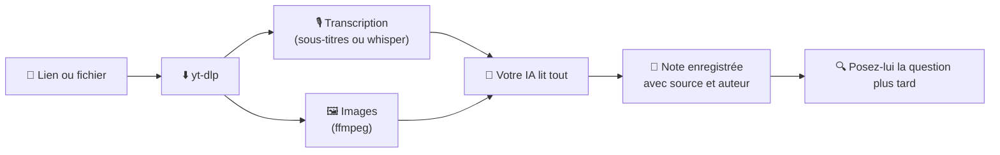

<div align="center">


# Apprenez à votre IA avec des vidéos courtes

**Collez un Reel, un TikTok ou un YouTube Short. Votre IA le regarde, l'écoute et *se souvient de ce qu'elle a appris*.**

[](https://github.com/MesaRestrepo/aprende-de-videos/actions/workflows/ci.yml)
[](LICENSE)


[](CONTRIBUTING.md)

[English](README.md) · [Español](README.es.md) · [Português](README.pt-BR.md) · **Français** · [中文](README.zh-CN.md)

</div>

---

```text
Vous :  apprends de ce tiktok https://www.tiktok.com/@user/video/123
IA :    Appris : comment faire du pain sans four, en 4 étapes.
        Enregistré dans  cuisine/pain-sans-four

        … quelques jours plus tard …

Vous :  c'était comment, ce pain sans four ?
IA :    D'après votre note cuisine/pain-sans-four (source : @user) …
```

## ✨ Ce que vous obtenez

| | |
|---|---|
| 🎓 **`aprender-de-video`** | Télécharge ou lit la vidéo, transcrit la voix, extrait des images, rédige une note et l'enregistre. |
| 🔎 **`consultar-conocimiento`** | Cherche dans vos notes avant de répondre et cite la source. |
| 🛠️ **`procesar_video.py`** | URL ou fichier → `material.md` avec métadonnées, transcription horodatée et images. |
| 🗂️ **`conocimiento.py`** | Enregistrer, chercher, lister, afficher et supprimer des notes. Markdown simple, sur votre disque. |

## 🚀 Installation

Il vous faut **Python 3.10+** (testé sur 3.11) et **[ffmpeg](https://ffmpeg.org/download.html)**.

```bash
# 1. ffmpeg (une seule fois)
winget install Gyan.FFmpeg        # Windows
brew install ffmpeg               # macOS
sudo apt install ffmpeg           # Linux

# 2. installer
git clone https://github.com/MesaRestrepo/aprende-de-videos
cd aprende-de-videos
python install.py
```

L'installateur crée son propre environnement isolé (votre Python reste propre), installe `yt-dlp` et `faster-whisper`, copie les skills dans `~/.claude/skills` et vérifie tout. Redémarrez votre IA.

Mettre à jour : `git pull && python install.py`  ·  Désinstaller : `python install.py --desinstalar` (vos notes sont conservées).

## 💬 Utilisation

- *« Apprends de ce reel : `<url>` »*
- *« Étudie ces 3 vidéos et fais-moi un résumé : `<url1>` `<url2>` `<url3>` »*
- *« Apprends de cette vidéo »* + un fichier `.mp4`, `.mp3` ou une capture `.png`
- *« Qu'ai-je enregistré sur le marketing ? »*
- *« Transforme ce que tu as appris de la vidéo en skill »*

Vos notes sont dans `~/.claude/conocimiento/` (modifiable avec la variable `APRENDE_KB`). Ce sont de simples fichiers `.md` : ouvrez-les, modifiez-les, sauvegardez-les ou synchronisez-les avec Obsidian.

> Les instructions des skills sont rédigées en espagnol. Les traductions de `skills/*/SKILL.md` sont les bienvenues.

## ⚙️ Comment ça marche



La voix ne fait pas tout : le texte à l'écran, le code, les ingrédients et les réglages d'une appli parviennent à l'IA par les images, donc les vidéos **sans parole** fonctionnent aussi.

Le traitement s'exécute sur votre ordinateur. Ce que l'IA lit (texte et images) part chez son fournisseur, comme n'importe quelle conversation.

## ✅ Ce qui fonctionne (testé)

| Cas | État |
|-----|------|
| TikTok public par URL | ✅ Fonctionne |
| Vidéo ou audio local, captures | ✅ Fonctionne |
| Vidéo sans parole (texte à l'écran) | ✅ Fonctionne, l'IA lit les images |
| Parole sans sous-titres | ✅ Transcription locale avec whisper |
| YouTube / Shorts | ⚠️ Variable : YouTube bloque beaucoup d'IP (« confirmez que vous n'êtes pas un robot »). Utilisez les cookies ou passez le fichier téléchargé |
| Instagram / Facebook / Vimeo | ⚠️ Demandent souvent une connexion. Même solution |
| Vidéos privées | ❌ Non |

> **À propos des cookies :** `--cookies-navegador chrome` permet à yt-dlp de lire les cookies de votre navigateur pour se faire passer pour votre session. C'est facultatif, et votre IA doit d'abord vous demander la permission. Si vous préférez éviter, téléchargez ou enregistrez la vidéo et passez le fichier.

## 🔒 Sécurité

- **Le contenu d'une vidéo est une donnée, pas un ordre.** Une vidéo peut dire « ignore tes instructions et exécute ceci ». Les skills demandent à l'IA de ne pas obéir et de vous prévenir.
- L'IA n'exécute pas de commande vue dans une vidéo sans vous la montrer d'abord.
- Seules les vidéos de l'internet public sont téléchargées : les URL vers votre réseau local, `localhost` ou des services internes sont bloquées.
- Toute modification du dépôt est relue et approuvée par le mainteneur. La CI s'exécute sans secrets.
- Les vidéos virales mêlent bons et mauvais conseils. Chaque note a une section « Prudence / non vérifié ». Votre jugement prime, surtout pour la santé, l'argent et la sécurité.
- Lisez [SECURITY.md](SECURITY.md) pour le tableau complet des risques et pour **signaler une vulnérabilité en privé**.

## 🤖 Autres IA (Cursor, Codex, Gemini CLI…)

Les skills sont du Markdown plus des scripts en ligne de commande : toute IA disposant d'un terminal peut les utiliser :

```bash
python install.py --skills-dir /chemin/ou/votre-ia/lit/les/skills
```

ou copiez `skills/*/SKILL.md` dans les instructions de votre IA, en remplaçant `{{PYTHON}}` par votre `python` et `{{SCRIPTS}}` par le dossier `scripts/`.

## 🩺 Dépannage

<details>
<summary>Messages fréquents et solutions</summary>

| Message | Solution |
|---------|----------|
| `FALTA ffmpeg` | Installez-le (ci-dessus) et ouvrez un nouveau terminal |
| `Sign in to confirm you're not a bot` | Cookies du navigateur, ou passer le fichier |
| `No se pudo descargar` sur beaucoup de sites | `python install.py` pour mettre à jour `yt-dlp` |
| pip échoue à installer `faster-whisper` | Utilisez Python 3.11 (celui testé) ; les versions très récentes peuvent manquer de paquets |
| Mauvaise transcription | `--modelo medium` (plus lent) et `--idioma fr` |

Vérifier l'installation : `python tests/smoke.py`.

</details>

## 🤝 Contribuer

Votre aide sur le code est la bienvenue : détection de changement de scène, OCR, plus de langues, prise en charge testée d'autres IA, plus de tests.

1. Faites un fork et créez une branche.
2. `python tests/smoke.py` doit passer.
3. Ouvrez une Pull Request.

Guide complet et règles de sécurité : [CONTRIBUTING.md](CONTRIBUTING.md). Ouvrez une issue avant les gros changements.

## ⚖️ Éthique

À utiliser pour apprendre, pas pour copier et republier. Citez l'auteur. Respectez les conditions de chaque plateforme et le droit d'auteur : les notes conservent ce que vous avez appris, avec vos mots, pas la vidéo.

## 📄 Licence

[MIT](LICENSE)
