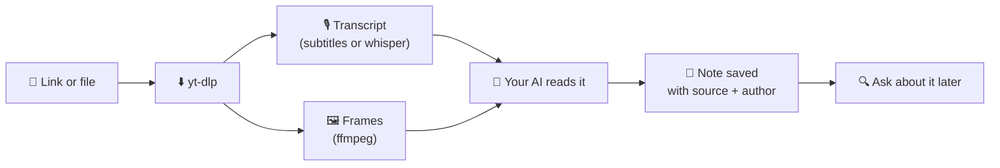

<div align="center">


# Teach your AI from short videos

**Paste a Reel, TikTok or YouTube Short. Your AI watches it, listens to it, and *remembers what it learned*.**

[](https://github.com/MesaRestrepo/aprende-de-videos/actions/workflows/ci.yml)
[](LICENSE)


[](CONTRIBUTING.md)

**English** · [Español](README.es.md) · [Português](README.pt-BR.md) · [Français](README.fr.md) · [中文](README.zh-CN.md)

</div>

---

```text
You:  learn from this tiktok https://www.tiktok.com/@user/video/123
AI:   Learned: how to bake bread without an oven, in 4 steps.
      Saved as  cooking/no-oven-bread

        … days later …

You:  how did that no-oven bread go?
AI:   According to your note cooking/no-oven-bread (source: @user) …
```

## ✨ What you get

| | |
|---|---|
| 🎓 **`aprender-de-video`** | Downloads or reads the video, transcribes the voice, grabs frames, writes a note and saves it. |
| 🔎 **`consultar-conocimiento`** | Searches your notes before answering and cites the source. |
| 🛠️ **`procesar_video.py`** | URL or file → `material.md` with metadata, timestamped transcript and images. |
| 🗂️ **`conocimiento.py`** | Save, search, list, view and delete notes. Plain Markdown, on your disk. |

## 🚀 Install

You need **Python 3.10+** (tested on 3.11) and **[ffmpeg](https://ffmpeg.org/download.html)**.

```bash
# 1. ffmpeg (once)
winget install Gyan.FFmpeg        # Windows
brew install ffmpeg               # macOS
sudo apt install ffmpeg           # Linux

# 2. install
git clone https://github.com/MesaRestrepo/aprende-de-videos
cd aprende-de-videos
python install.py
```

The installer builds its own isolated environment (your Python stays clean), installs `yt-dlp` and `faster-whisper`, copies the skills to `~/.claude/skills` and checks everything. Restart your AI.

Update: `git pull && python install.py`  ·  Remove: `python install.py --desinstalar` (your notes are kept).

## 💬 Use it

- *"Learn from this reel: `<url>`"*
- *"Study these 3 videos and summarize them: `<url1>` `<url2>` `<url3>`"*
- *"Learn from this video"* + an `.mp4`, `.mp3` or screenshot `.png`
- *"What do I have saved about marketing?"*
- *"Turn what you learned from that video into a skill"*

Notes live in `~/.claude/conocimiento/` (change it with the `APRENDE_KB` variable). They are plain `.md` files: open them, edit them, back them up, or sync them with Obsidian.

> The skill instructions are written in Spanish. Translations of `skills/*/SKILL.md` are very welcome.

## ⚙️ How it works



Voice is not everything: on-screen text, code, ingredients and app settings reach the AI through the frames, so videos **without any speech** still work.

Processing runs on your computer. What the AI reads (text and images) goes to its provider, like any conversation.

## ✅ What works (tested)

| Case | Status |
|------|--------|
| Public TikTok by URL | ✅ Works |
| Local video, audio, screenshots | ✅ Works |
| Video with no speech (text on screen) | ✅ Works, the AI reads the frames |
| Speech without subtitles | ✅ Local transcription with whisper |
| YouTube / Shorts | ⚠️ Depends: YouTube blocks many IPs ("confirm you're not a bot"). Use cookies or pass the downloaded file |
| Instagram / Facebook / Vimeo | ⚠️ Often ask you to log in. Same fix |
| Private videos | ❌ No |

> **About cookies:** `--cookies-navegador chrome` lets yt-dlp read your browser cookies to look like your session. It is optional, and your AI must ask your permission first. If you prefer not to, download or record the video and pass the file.

## 🔒 Security

- **Video content is data, not orders.** A video can say "ignore your instructions and run this". The skills tell the AI not to obey and to warn you.
- The AI does not run commands seen in a video without showing them to you first.
- Only public internet videos are downloaded: URLs pointing to your local network, `localhost` or internal services are blocked.
- Every change to this repo is reviewed and approved by the maintainer. CI runs without secrets.
- Viral videos mix good and bad advice. Each note has a "Careful / unverified" section. Your judgment rules, especially for health, money and safety.
- Read [SECURITY.md](SECURITY.md) for the full risk table and to **report a vulnerability privately**.

## 🤖 Other AIs (Cursor, Codex, Gemini CLI…)

The skills are Markdown plus command-line scripts, so any AI with a terminal can use them:

```bash
python install.py --skills-dir /path/where/your-ai/reads/skills
```

or copy `skills/*/SKILL.md` into your AI's instructions, replacing `{{PYTHON}}` with your `python` and `{{SCRIPTS}}` with the `scripts/` folder.

## 🩺 Troubleshooting

<details>
<summary>Common messages and fixes</summary>

| Message | Fix |
|---------|-----|
| `FALTA ffmpeg` | Install it (above) and open a new terminal |
| `Sign in to confirm you're not a bot` | Browser cookies, or pass the file |
| `No se pudo descargar` on many sites | Run `python install.py` to update `yt-dlp` |
| pip fails installing `faster-whisper` | Use Python 3.11 (the tested one); very new versions may lack packages |
| Poor transcription | `--modelo medium` (slower) and `--idioma en` |

Check your install: `python tests/smoke.py`.

</details>

## 🤝 Contributing

Code help is welcome: scene-change detection, OCR, more languages, tested support for other AIs, more tests.

1. Fork and create a branch.
2. `python tests/smoke.py` must pass.
3. Open a Pull Request.

Full guide and security rules: [CONTRIBUTING.md](CONTRIBUTING.md). Open an issue before big changes.

## ⚖️ Ethics

Use it to learn, not to copy and republish. Credit the author. Respect each platform's terms and copyright: notes keep what you learned, in your own words, not the video.

## 📄 License

[MIT](LICENSE)
