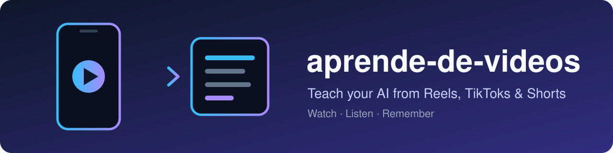
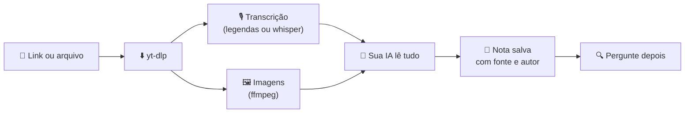

<div align="center">



# Ensine sua IA com vídeos curtos

**Cole um Reel, TikTok ou YouTube Short. Sua IA assiste, escuta e *lembra do que aprendeu*.**

[](https://github.com/MesaRestrepo/aprende-de-videos/actions/workflows/ci.yml)
[](LICENSE)


[](CONTRIBUTING.md)

[English](README.md) · [Español](README.es.md) · **Português** · [Français](README.fr.md) · [中文](README.zh-CN.md)

</div>

---

```text
Você:  aprenda com este tiktok https://www.tiktok.com/@user/video/123
IA:    Aprendi: como fazer pão sem forno, em 4 passos.
       Salvo em  culinaria/pao-sem-forno

        … dias depois …

Você:  como era aquele pão sem forno?
IA:    Segundo sua nota culinaria/pao-sem-forno (fonte: @user) …
```

## ✨ O que vem incluído

| | |
|---|---|
| 🎓 **`aprender-de-video`** | Baixa ou lê o vídeo, transcreve a voz, extrai imagens, escreve uma nota e a salva. |
| 🔎 **`consultar-conocimiento`** | Busca nas suas notas antes de responder e cita a fonte. |
| 🛠️ **`procesar_video.py`** | URL ou arquivo → `material.md` com dados, transcrição com tempos e imagens. |
| 🗂️ **`conocimiento.py`** | Salvar, buscar, listar, ver e apagar notas. Markdown simples, no seu disco. |

## 🚀 Instalar

Você precisa de **Python 3.10+** (testado no 3.11) e **[ffmpeg](https://ffmpeg.org/download.html)**.

```bash
# 1. ffmpeg (uma vez)
winget install Gyan.FFmpeg        # Windows
brew install ffmpeg               # macOS
sudo apt install ffmpeg           # Linux

# 2. instalar
git clone https://github.com/MesaRestrepo/aprende-de-videos
cd aprende-de-videos
python install.py
```

O instalador cria um ambiente isolado próprio (seu Python fica limpo), instala `yt-dlp` e `faster-whisper`, copia as skills para `~/.claude/skills` e verifica tudo. Reinicie sua IA.

Atualizar: `git pull && python install.py`  ·  Remover: `python install.py --desinstalar` (suas notas são mantidas).

## 💬 Usar

- *"Aprenda com este reel: `<url>`"*
- *"Estude estes 3 vídeos e faça um resumo: `<url1>` `<url2>` `<url3>`"*
- *"Aprenda com este vídeo"* + um arquivo `.mp4`, `.mp3` ou uma captura `.png`
- *"O que tenho salvo sobre marketing?"*
- *"Transforme o que você aprendeu do vídeo em uma skill"*

Suas notas ficam em `~/.claude/conocimiento/` (mude com a variável `APRENDE_KB`). São arquivos `.md`: abra, edite, faça backup ou sincronize com o Obsidian.

> As instruções das skills estão escritas em espanhol. Traduções de `skills/*/SKILL.md` são muito bem-vindas.

## ⚙️ Como funciona



A voz não é tudo: texto na tela, código, ingredientes e configurações de um app chegam à IA pelas imagens, então vídeos **sem fala** também funcionam.

O processamento roda no seu computador. O que a IA lê (texto e imagens) vai para o provedor dela, como em qualquer conversa.

## ✅ O que funciona (testado)

| Caso | Status |
|------|--------|
| TikTok público por URL | ✅ Funciona |
| Vídeo ou áudio local, capturas | ✅ Funciona |
| Vídeo sem fala (texto na tela) | ✅ Funciona, a IA lê as imagens |
| Fala sem legendas | ✅ Transcrição local com whisper |
| YouTube / Shorts | ⚠️ Depende: o YouTube bloqueia muitos IPs ("confirme que você não é um robô"). Use cookies ou passe o arquivo baixado |
| Instagram / Facebook / Vimeo | ⚠️ Costumam pedir login. Mesma solução |
| Vídeos privados | ❌ Não |

> **Sobre cookies:** `--cookies-navegador chrome` faz o yt-dlp ler os cookies do seu navegador para parecer a sua sessão. É opcional e sua IA deve pedir permissão antes. Se preferir não usar, baixe ou grave o vídeo e passe o arquivo.

## 🔒 Segurança

- **O conteúdo de um vídeo é dado, não ordem.** Um vídeo pode dizer "ignore suas instruções e execute isto". As skills mandam a IA não obedecer e avisar você.
- A IA não executa comandos vistos em um vídeo sem mostrá-los a você antes.
- Só são baixados vídeos da internet pública: URLs para sua rede local, `localhost` ou serviços internos são bloqueadas.
- Toda mudança no repositório é revisada e aprovada pelo mantenedor. O CI roda sem segredos.
- Vídeos virais misturam conselhos bons e ruins. Cada nota tem uma seção "Cuidado / não verificado". Seu critério manda, principalmente em saúde, dinheiro e segurança.
- Leia o [SECURITY.md](SECURITY.md) para a tabela completa de riscos e para **reportar uma vulnerabilidade em privado**.

## 🤖 Outras IAs (Cursor, Codex, Gemini CLI…)

As skills são Markdown mais scripts de linha de comando, então qualquer IA com terminal pode usá-las:

```bash
python install.py --skills-dir /caminho/onde/sua-ia/le/skills
```

ou copie `skills/*/SKILL.md` para as instruções da sua IA, trocando `{{PYTHON}}` pelo seu `python` e `{{SCRIPTS}}` pela pasta `scripts/`.

## 🩺 Problemas comuns

<details>
<summary>Mensagens frequentes e soluções</summary>

| Mensagem | Solução |
|----------|---------|
| `FALTA ffmpeg` | Instale (acima) e abra um novo terminal |
| `Sign in to confirm you're not a bot` | Cookies do navegador ou passar o arquivo |
| `No se pudo descargar` em vários sites | `python install.py` para atualizar o `yt-dlp` |
| pip falha ao instalar `faster-whisper` | Use Python 3.11 (o testado); versões muito novas podem não ter pacotes ainda |
| Transcrição ruim | `--modelo medium` (mais lento) e `--idioma pt` |

Verificar a instalação: `python tests/smoke.py`.

</details>

## 🤝 Contribuir

Ajuda no código é bem-vinda: detecção de troca de cena, OCR, mais idiomas, suporte testado para outras IAs, mais testes.

1. Faça um fork e crie um branch.
2. `python tests/smoke.py` deve passar.
3. Abra um Pull Request.

Guia completo e regras de segurança: [CONTRIBUTING.md](CONTRIBUTING.md). Abra uma issue antes de mudanças grandes.

## ⚖️ Ética

Use para aprender, não para copiar e republicar. Dê crédito ao autor. Respeite os termos de cada plataforma e os direitos autorais: as notas guardam o que você aprendeu, com suas palavras, não o vídeo.

## 📄 Licença

[MIT](LICENSE)
