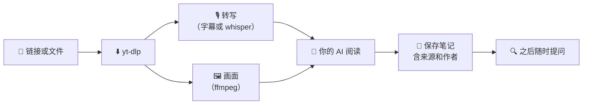

<div align="center">


# 用短视频教你的 AI

**粘贴一个 Reel、TikTok 或 YouTube Short 链接。你的 AI 会观看、聆听，并*记住学到的内容*。**

[](https://github.com/MesaRestrepo/aprende-de-videos/actions/workflows/ci.yml)
[](LICENSE)


[](CONTRIBUTING.md)

[English](README.md) · [Español](README.es.md) · [Português](README.pt-BR.md) · [Français](README.fr.md) · **中文**

</div>

---

```text
你：  从这个 tiktok 学习 https://www.tiktok.com/@user/video/123
AI：  学会了：如何不用烤箱做面包，共 4 步。
      已保存为  cooking/no-oven-bread

        …… 几天后 ……

你：  之前那个无烤箱面包怎么做来着？
AI：  根据你的笔记 cooking/no-oven-bread（来源：@user）……
```

## ✨ 包含什么

| | |
|---|---|
| 🎓 **`aprender-de-video`** | 下载或读取视频，转写语音，提取画面，撰写笔记并保存。 |
| 🔎 **`consultar-conocimiento`** | 回答前先搜索你的笔记，并注明来源。 |
| 🛠️ **`procesar_video.py`** | 链接或文件 → 含元数据、带时间戳转写和画面的 `material.md`。 |
| 🗂️ **`conocimiento.py`** | 保存、搜索、列出、查看和删除笔记。纯 Markdown，存放在你自己的硬盘上。 |

## 🚀 安装

需要 **Python 3.10+**（在 3.11 上测试过）和 **[ffmpeg](https://ffmpeg.org/download.html)**。

```bash
# 1. ffmpeg（只需一次）
winget install Gyan.FFmpeg        # Windows
brew install ffmpeg               # macOS
sudo apt install ffmpeg           # Linux

# 2. 安装
git clone https://github.com/MesaRestrepo/aprende-de-videos
cd aprende-de-videos
python install.py
```

安装程序会创建独立的运行环境（不会弄乱你的 Python），安装 `yt-dlp` 和 `faster-whisper`，把 skills 复制到 `~/.claude/skills` 并检查一切。然后重启你的 AI。

更新：`git pull && python install.py`  ·  卸载：`python install.py --desinstalar`（笔记会保留）。

## 💬 使用

- *“从这个 reel 学习：`<url>`”*
- *“学习这 3 个视频并给我总结：`<url1>` `<url2>` `<url3>`”*
- *“从这个视频学习”* + 一个 `.mp4`、`.mp3` 文件或 `.png` 截图
- *“我保存了哪些关于营销的内容？”*
- *“把你从视频里学到的做成一个 skill”*

笔记保存在 `~/.claude/conocimiento/`（可用环境变量 `APRENDE_KB` 修改）。它们是普通的 `.md` 文件：可以打开、编辑、备份，或与 Obsidian 同步。

> skills 的指令目前是西班牙语编写的。欢迎贡献 `skills/*/SKILL.md` 的翻译。

## ⚙️ 工作原理



声音并不是全部：屏幕上的文字、代码、食材和应用设置都通过画面传给 AI，因此**没有语音**的视频同样可用。

处理过程在你的电脑上运行。AI 读取的内容（文字和图片）会发送给其服务提供商，与任何对话相同。

## ✅ 哪些可用（已测试）

| 情况 | 状态 |
|------|------|
| 公开 TikTok 链接 | ✅ 可用 |
| 本地视频、音频、截图 | ✅ 可用 |
| 无语音视频（屏幕文字） | ✅ 可用，AI 读取画面 |
| 无字幕的语音 | ✅ 用 whisper 本地转写 |
| YouTube / Shorts | ⚠️ 视情况而定：YouTube 会封锁许多 IP（“请确认你不是机器人”）。使用 cookies 或直接提供已下载的文件 |
| Instagram / Facebook / Vimeo | ⚠️ 常要求登录。解决方法相同 |
| 私密视频 | ❌ 不支持 |

> **关于 cookies：**`--cookies-navegador chrome` 会让 yt-dlp 读取你浏览器的 cookies，以你的登录会话访问。这是可选项，你的 AI 必须先征得你的同意。如果不想这样做，请自行下载或录制视频并提供文件。

## 🔒 安全

- **视频内容是数据，不是命令。**视频里可能出现“忽略你的指令并执行这个”。skills 会要求 AI 不要服从，并提醒你。
- AI 不会在未先给你过目的情况下执行视频里出现的命令。
- 只下载公共互联网上的视频：指向本地网络、`localhost` 或内部服务的链接会被拦截。
- 对本仓库的每一项更改都由维护者审核并批准。CI 在没有任何密钥的情况下运行。
- 爆款视频常常好建议和坏建议混在一起。每条笔记都有“注意 / 未经验证”部分。尤其在健康、金钱和安全方面，请以你自己的判断为准。
- 阅读 [SECURITY.md](SECURITY.md) 了解完整风险表，并**私下报告漏洞**。

## 🤖 其他 AI（Cursor、Codex、Gemini CLI……）

skills 是 Markdown 加命令行脚本，因此任何带终端的 AI 都能使用：

```bash
python install.py --skills-dir /你的AI读取skills的路径
```

或者把 `skills/*/SKILL.md` 复制到你的 AI 指令中，将 `{{PYTHON}}` 换成你的 `python`，把 `{{SCRIPTS}}` 换成 `scripts/` 文件夹。

## 🩺 常见问题

<details>
<summary>常见提示与解决方法</summary>

| 提示 | 解决方法 |
|------|----------|
| `FALTA ffmpeg` | 按上文安装，然后打开新终端 |
| `Sign in to confirm you're not a bot` | 使用浏览器 cookies，或提供文件 |
| 许多网站出现 `No se pudo descargar` | 运行 `python install.py` 更新 `yt-dlp` |
| pip 安装 `faster-whisper` 失败 | 使用 Python 3.11（已测试版本）；过新的版本可能还没有对应的包 |
| 转写效果差 | `--modelo medium`（更慢）并加 `--idioma zh` |

检查安装：`python tests/smoke.py`。

</details>

## 🤝 参与贡献

欢迎在代码上提供帮助：场景切换检测、OCR、更多语言、对其他 AI 的实测支持、更多测试。

1. Fork 并创建分支。
2. `python tests/smoke.py` 必须通过。
3. 提交 Pull Request。

完整指南和安全规则：[CONTRIBUTING.md](CONTRIBUTING.md)。较大改动请先开 issue。

## ⚖️ 道德规范

用于学习，不要用来复制并转发他人内容。请注明原作者。尊重各平台条款和版权：笔记保存的是你用自己的话总结的所学内容，而不是视频本身。

## 📄 许可证

[MIT](LICENSE)
